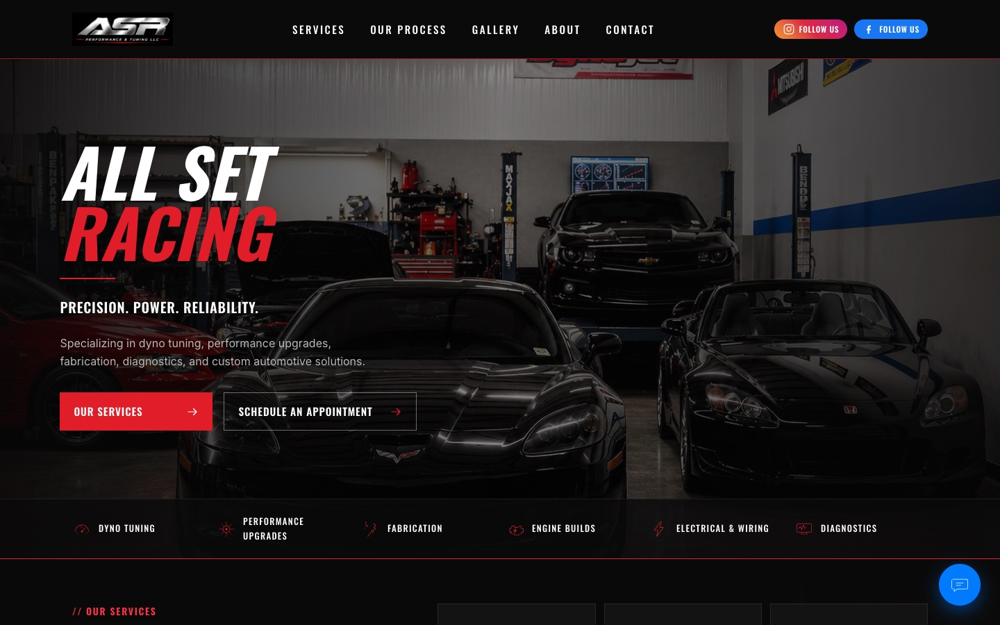

# ASR Performance & Tuning 🏁

**🌐 [asrperformanceva.com](https://asrperformanceva.com)**



Sitio web one-page para **ASR Performance & Tuning LLC**, un taller de preparación de autos en Ashland, Virginia (EE.UU.): dyno tuning, upgrades de rendimiento, fabricación, armado de motores, sistema eléctrico y diagnóstico.

## Qué tiene

- Hero, servicios, proceso de trabajo, galería, preguntas frecuentes y contacto.
- **Formulario de contacto** con validaciones (Reactive Forms) que envía por EmailJS.
- Diseño propio desde Figma, **sin librerías de UI**: SCSS con design tokens en variables CSS.
- Responsivo y optimizado para SEO.

## Arquitectura

Angular 16 con **standalone components**, `OnPush` y **Signals**, organizado por principios SOLID:

```
src/app/
├── core/       # servicios, modelos y tokens de inyección (ContentService, EmailService…)
├── shared/     # componentes reutilizables
└── sections/   # cada sección de la página
```

## Stack


## Correr en local

```bash
npm ci
npm start        # http://localhost:4200
npm test         # Karma + Jasmine
npm run build    # dist/asr-web
```
